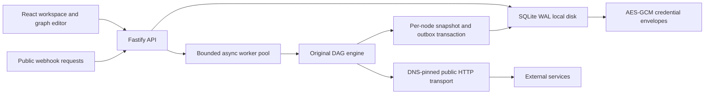
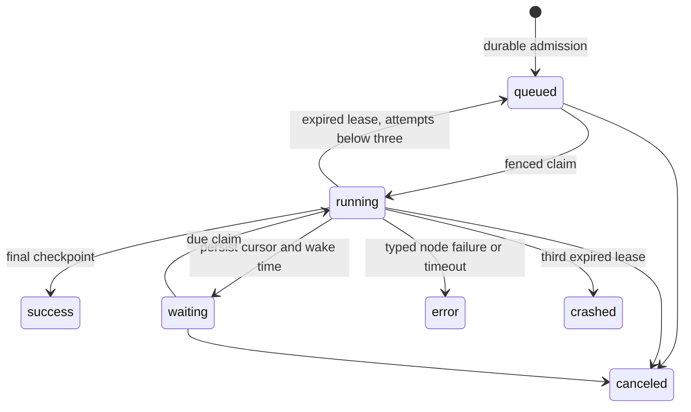

# Runtime architecture and scale gates

## What runs today

One process owns the API and four default async execution slots. The durable store is the coordination authority. Queue insertion, idempotency reservation and the queued event commit atomically. Acknowledgement follows commit. Claims use `BEGIN IMMEDIATE` and issue a fencing token. Checkpoint/finish statements require that token and running status, so a canceled or reclaimed worker cannot commit stale output. Each checkpoint identifies the next node to execute; the pinned graph is stored in the run independently of editable workflow state.

The traversal is stable topological order over a validated single-root DAG. Multiple outgoing edges fan out; multiple incoming edges append their outputs in edge order. This does not implement join-by-key, binary data, loops or branch ports. A false filter yields zero items; downstream mapping/HTTP nodes receive no items. All structural nodes remain bounded by node, edge, item and byte limits.

Waits occupy storage rather than a worker slot. Claim timestamps use the host clock in this release; NTP is required. Shutdown stops consumption, aborts active transports and drains task promises before closing SQLite. A hard kill is recovered by lease expiry. A failed node terminates the run; there is no automatic node retry or error-workflow routing. Workflow history can be loaded into the editor and saved as a new revision.

## Security boundaries

- The browser receives credential metadata only. Decryption happens inside dispatch for the matching project and exact HTTPS host.
- Expressions parse into a closed AST allowlist, then closures. JSON data does not obtain process, module, function or prototype access.
- Each authenticated resource lookup constrains project ID. Owners manage users; editors create/change/run; viewers inspect only.
- Webhooks are explicitly public. Current rate limiting is process-local. Their unguessable URL is not a substitute for request-signature verification when exposing sensitive integrations.
- Node outputs and inputs can contain business data. Restrict database, exports and execution access accordingly; retention automation is not yet available.
- Single master-key encryption has no online rotation. Change management must decrypt and re-encrypt all envelopes atomically under an approved migration before replacing the key.

## Tier L target topology (unimplemented)

API/ingress, workers, trigger hosts and isolated task runners become separate stateless roles. PostgreSQL owns workflow versions, execution states, audit and an outbox; Redis-Q owns independently provisioned manual/prod/sub/resume/bulk queues; Redis-C handles caches and live progress. Object storage holds binary and cold execution data. Admission uses queue depth and workflow/project semaphores. Resume queues must not be shed. Read replicas serve lists while push events bridge replica lag.

Migration sequence: define asynchronous repository/queue interfaces and contract tests; implement PostgreSQL transactions and partition migrations; implement Redis bulkheads and lease semantics; add outbox relay with consumer deduplication; implement object storage and compaction; add distributed trigger lifecycle; test controlled failover and recovery; run load and chaos gates before any capacity claim. Keep existing pinned-version, idempotency and fencing invariants during that migration.

## Evidence required before a production scale claim

| Gate                         | Current evidence                                                                           |
| ---------------------------- | ------------------------------------------------------------------------------------------ |
| Graph/expression correctness | Deterministic cases, escape rejection, data bounds and wait snapshots tested               |
| Resource access              | Viewer denial, cross-project IDOR denial, CSRF and credential metadata tested              |
| Durable admission            | Duplicate requests, revision pinning, outbox writes, lease fencing and cancellation tested |
| Browser flow                 | Create/edit/save/run success plus 28 page/breakpoint axe checks                            |
| Crash/no-loss                | Lease expiry simulated; no process-kill-under-load or data-layer failover test yet         |
| 10M/day, p99 webhook SLO     | No representative load result; target remains unverified                                   |
| HA, PITR, retention          | Not implemented                                                                            |
| Full enterprise product      | Remaining requirements in BACKLOG.md                                                       |
